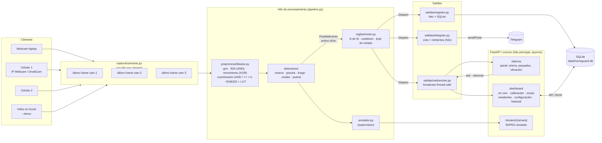
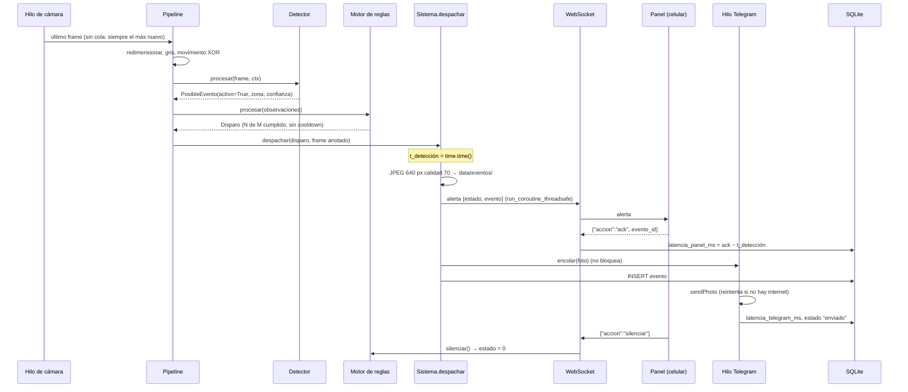
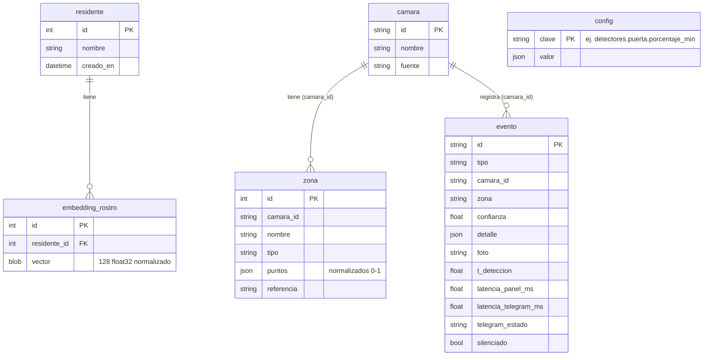

# Arquitectura de HomeGuard AI

## Vista general



## Secuencia de una alarma



## Hilos y concurrencia

| Hilo | Qué hace | Cómo se comunica |
|---|---|---|
| `captura-<cámara>` (uno por cámara) | Lee frames lo más rápido posible y guarda solo el último (`FrameCapturado`). Reconexión con espera exponencial. | El pipeline llama a `leer()` (con lock). |
| `procesamiento` (uno) | Recorre las cámaras, analiza el frame nuevo de cada una, corre el motor y despacha. Produce el JPEG anotado y la telemetría. | Escribe en `pipeline.jpeg` y `pipeline.calibracion`; emite por WebSocket con `run_coroutine_threadsafe`. |
| `telegram` (uno) | Consume la cola de envíos con reintentos. | `queue.Queue`; al terminar llama a un callback que actualiza la BD. |
| principal (uvicorn) | FastAPI: páginas, API, WebSockets, stream MJPEG. | Recibe acks y "silenciar" desde el panel. |

Telegram y la base de datos nunca demoran al panel. La alerta sale por WebSocket antes de encolar Telegram y antes
de escribir en la BD. Si el ack del panel llega antes de que el evento esté en la BD, se guarda y se aplica
apenas se inserta.

Para no gastar CPU, no todos los modelos corren en todos los frames:
- el YOLO general (personas y mascotas) corre solo si algún detector lo pide en ese frame (piscina, o rostros con
  una zona "acceso") y se comparte entre ambos;
- YuNet + SFace corren solo si YOLO ve una persona dentro de la zona "acceso";
- el YOLO de fuego corre solo si la capa 1 bitwise supera su umbral;
- la pose corre cada `detectores.caidas.cada_n_frames` frames.

## Módulos

| Módulo | Responsabilidad |
|---|---|
| `run.py` | Argumentos (`--demo`, `--sin-telegram`, `--puerto`), logs, genera los videos sintéticos si faltan, arranca uvicorn. |
| `homeguard/config.py` | Modelos pydantic de `config.yaml` (con `extra="forbid"`), overrides con claves de puntos, secretos de `.env`, lectura de los comentarios del YAML para el dashboard. |
| `homeguard/sistema.py` | Orquestador: crea los componentes, aplica cambios de configuración en caliente y hace el `despachar()` de alarmas, los acks y el silenciar. |
| `homeguard/pipeline.py` | Hilo de procesamiento, FPS por cámara, JPEG del stream, telemetría (CPU, RAM, calibración). |
| `homeguard/analizador.py` | Preproceso + ejecución de los detectores de una cámara. Lo comparten el pipeline y `scripts/evaluar_detector.py`. |
| `homeguard/anotador.py` | Dibuja zonas, detecciones y etiquetas con los anotadores de supervision. |
| `captura/camaras.py` | `Camara` (hilo, reconexión, bucle de archivos a velocidad real) y `GestorCamaras` (sincroniza con la config). |
| `preproceso/bitwise.py` | Máscaras ROI (AND/OR), movimiento (XOR de cuantizados), cuantización, RGB332 + LUT, XOR de binarizadas. |
| `preproceso/benchmark.py` | 5 variantes de la capa 1 de fuego, de bucle Python a bits vectorizados con ROI → `docs/BENCHMARK.md`. |
| `detectores/base.py` | `Zona`, `PosibleEvento`, `Contexto` (frame, tiempo, zonas, movimiento, detecciones YOLO perezosas), `EstadoCamara`. |
| `detectores/modelos.py` | Carga perezosa y cacheada de YOLO, YuNet y SFace. |
| `detectores/puerta.py` · `fuego.py` · `piscina.py` · `caidas.py` · `rostros.py` | Un detector por anomalía. Cada uno emite una observación por zona evaluada y escribe sus valores en `ctx.calibracion`. |
| `reglas/estado.py` | Byte de estado: un bit por anomalía. |
| `reglas/motor.py` | Votación N de M por (tipo, cámara, zona), cooldown, estado enclavado hasta silenciar, semáforo de "activos". |
| `salidas/websocket.py` | Conexiones por canal (`alarma`, `estado`) y broadcast desde otros hilos. |
| `salidas/telegram.py` | Cola, `sendPhoto`/`sendMessage` con `requests`, reintentos, errores permanentes, descarte por antigüedad. |
| `salidas/registro.py` | JPEG del evento, fila en la BD, latencias, pendientes de Telegram. |
| `db/modelos.py` · `sesion.py` · `consultas.py` | SQLAlchemy (SQLite en modo WAL) y las consultas compartidas. |
| `web/app.py` · `api.py` | Páginas, WebSockets, MJPEG, snapshot, API JSON de zonas, residentes, configuración, cámaras y eventos. |
| `web/templates`, `web/static` | HTML (Jinja2), CSS propio y JS sin frameworks. |

## Contrato de los detectores

```python
class Detector:
    nombre: str   # nombre en config.yaml (rostros, piscina, fuego, caidas, puerta)
    tipo: str     # anomalía (intrusion, piscina, fuego, caida, puerta)
    def procesar(self, frame, ctx: Contexto) -> list[PosibleEvento]: ...
```

- Devuelven **una observación por zona evaluada**, con `activo=True/False`. Las negativas hacen falta para que
  el motor sepa cuántos frames se evaluaron (votación N de M).
- Usan siempre `ctx.t` (nunca `time.time()`), así los tests y el evaluador corren más rápido que el tiempo real.
- **No deciden alarmas.** Solo el motor de reglas enciende bits del byte de estado.
- Escriben sus valores crudos en `ctx.calibracion[nombre][zona]`, que se ven en la página de calibración.

## Modelo de datos (SQLite)



## Protocolo WebSocket

`/ws/alarma` (panel):

| Dirección | Mensaje |
|---|---|
| servidor → panel | `{"tipo":"estado","estado":20,"ultimo_evento":{...}}` al conectar y cada 0,5 s (también sirve de latido) |
| servidor → panel | `{"tipo":"alerta","estado":20,"evento":{"id","tipo","zona","camara","foto","hora",...}}` |
| panel → servidor | `{"accion":"ack","evento_id":"..."}` apenas llega una alerta |
| panel → servidor | `{"accion":"silenciar"}` · `{"accion":"ping"}` |

`/ws/estado` (dashboard): `{"tipo":"telemetria", estado, activos, camaras[], calibracion, ms_detectores,
cpu_sistema, cpu_proceso, ram_mb, telegram, paneles_conectados, ultimo_evento}`, además de las alertas.

El byte `estado` se decodifica igual en Python (`reglas/estado.py`) y en JavaScript (`(estado & (1 << n)) !== 0`).
